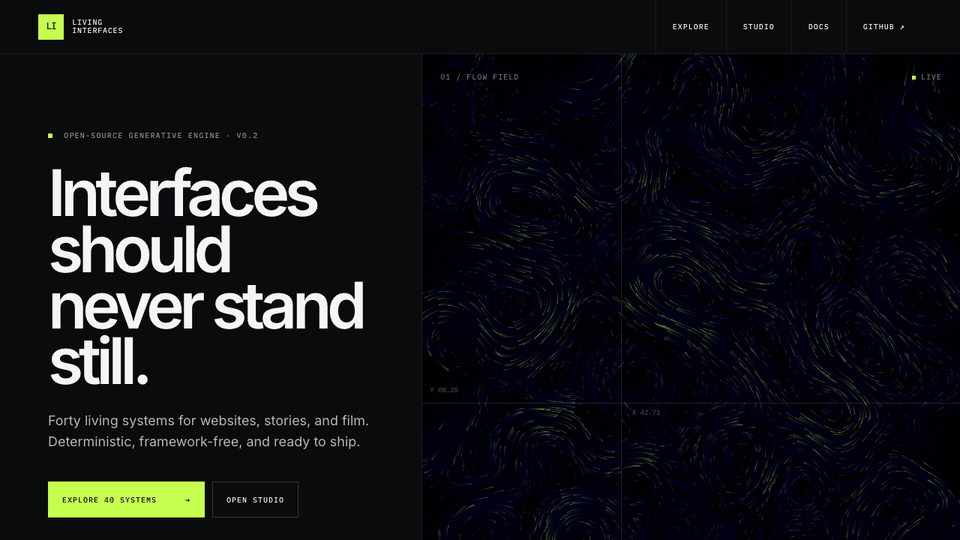
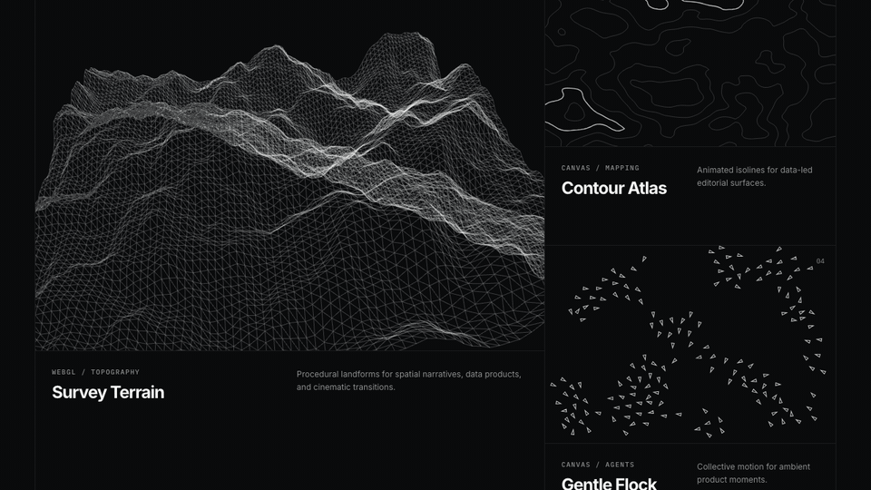

# Living Interfaces

[](tests)
[](LICENSE)
[](https://github.com/ahmedvnabil/living-interfaces/releases/latest)
[](https://ahmedvnabil.github.io/living-interfaces/)

<p align="center">
  <a href="https://ahmedvnabil.github.io/living-interfaces/">
    
  </a>
</p>

Framework-free generative visuals for websites, interactive stories, and video:
**40 visualization modules**, **12 presets**, a **16-piece UI component library**,
a browser **Studio**, and **25 showcase pages** — pure TypeScript compiled to
plain ES modules.

**[Explore the live library](https://ahmedvnabil.github.io/living-interfaces/)** ·
**[Open Studio](https://ahmedvnabil.github.io/living-interfaces/studio.html)** ·
**[Browse all 40 systems](https://ahmedvnabil.github.io/living-interfaces/catalog.html)** ·
**[Download v0.2.0](https://github.com/ahmedvnabil/living-interfaces/releases/latest)**

## The system catalog

<p align="center">
  
</p>

Each instrument is a real, interactive runtime—not a prerecorded background.
Tune its parameters, preserve an exact take with a deterministic seed, then embed
it, install it in WordPress, or export a video.

## Use it

### Web Component

```html
<link rel="stylesheet" href="https://cdn.jsdelivr.net/gh/ahmedvnabil/living-interfaces@v0.2.0/themes/tokens.css">
<living-asset
  type="flow-field"
  preset="flow-field-calm"
  seed="42"
  style="display:block;width:100%;height:70vh"
></living-asset>

<script type="module" src="https://cdn.jsdelivr.net/gh/ahmedvnabil/living-interfaces@v0.2.0/assets/web-component.js"></script>
```

### JavaScript

```bash
npm install github:ahmedvnabil/living-interfaces#v0.2.0
```

```js
import { mount } from 'living-interfaces';

const asset = await mount('#hero', {
  asset: 'flow-field',
  preset: 'flow-field-calm',
  theme: 'dark',
});

// asset.pause() · resume() · setTheme('light') · destroy()
```

Three.js is an optional peer dependency used by only three WebGL modules.
Canvas 2D, SVG, and worker modules have no runtime dependency.

### Develop locally

```bash
npm install
npm run check
npm run serve
```

Open `index.html` for the product site, `catalog.html` for the 40-system
laboratory, `examples/index.html` for showcases, and `docs/index.html` for
documentation.

## Use a standalone module without npm

```html
<link rel="stylesheet" href="/themes/tokens.css">
<div id="stage" style="width:640px;height:480px"></div>
<script type="importmap">
{ "imports": { "three": "https://cdn.jsdelivr.net/npm/three@0.165.0/build/three.module.min.js" } }
</script>
<script type="module">
  import FlowField from '/assets/simulations/flow-field.js';
  new FlowField().init(document.getElementById('stage'), { seed: 42 });
</script>
```

Only WebGL modules (`terrain-generator`, `mesh-morphing`, `procedural-clouds`) touch
`three`; everything else needs no import map at all. Offline? Point the import map at
`/vendor/three.module.js`.

## Public contract

Every asset implements:

```ts
init(container, options?)  // options: seed, theme, params, maxDpr, accessibility, autoPause
destroy()                  // full teardown — RAF, observers, listeners, GL, workers
pause() / resume()
resize()                   // automatic via ResizeObserver as well
setTheme('dark' | 'light' | tokens)
setData(payload)           // live-data entry point
```

Plus: seeded determinism (`{ seed }` reproduces a run exactly), automatic off-screen
pause, `prefers-reduced-motion` support, PNG export, SVG export where the geometry is
vector-native, FPS/heap/GPU metrics via `getMetrics()`, and mouse/touch influence in
every simulation. Hand-tracking, microphone, camera, MIDI, WebSocket and live-data
sources are stubbed behind one `InputSource` interface in `src/core/inputs.ts`.

## Layout

```
src/          TypeScript source (core, simulations, components, themes, shaders, workers, utils)
assets/       compiled ES modules — the thing you copy into other projects
themes/       tokens.css (dark + light) · lab.css (components, specimen cards)
vendor/       offline copies of Three.js + mp4-muxer, with third-party notices
examples/     25 application studies
docs/         generated documentation
index.html    product landing page
catalog.html  40-system specimen laboratory
```

## Open-source integrations

- **Web Component:** import `living-interfaces/web-component`.
- **Vanilla JavaScript:** use `mount()` or `createAsset()`.
- **WordPress:** build the Gutenberg block and shortcode ZIP with
  `npm run build:wp`.
- **Video:** open `studio.html` and export deterministic MP4/WebM/PNG output.
- **Interactive stories:** compose plain JSON scenes with `LivingStory`.

See [CONTRIBUTING.md](CONTRIBUTING.md) to add an asset and
[ROADMAP.md](ROADMAP.md) for the intentionally bounded next releases.

## Studio — video export

Open `studio.html`: pick any module, choose a resolution (HD / Full HD / QHD / square /
9:16 reels), keyframe parameters on the timeline (⏺ at the playhead, smoothstep
interpolation), then export:

- **Render MP4 · frame-accurate** — steps the simulation offline and encodes each
  frame with an exact timestamp through WebCodecs (`VideoEncoder`, H.264) muxed by
  the vendored `mp4-muxer`. The file plays at precisely the requested duration on
  any machine — no ffmpeg, no retiming, never a dropped frame. Browsers without
  WebCodecs fall back to the `captureStream(0)` WebM path. (Worker-rendered modules
  use realtime mode instead.)
- **Record realtime** — live capture of the running canvas, pointer interaction included.
- **PNG frame** and **Copy setup JSON** (module + seed + params + timeline) for reuse.

Seeded determinism means a take can be reproduced exactly.

## LivingStory — interactive films

`assets/player/living-story.js` turns scenes (plain JSON: module, headline, body,
`from`/`to` params, seed) into a scroll-driven film: scroll interpolates parameters,
scenes crossfade, and the viewer's pointer still disturbs every simulation.
See `examples/interactive-film.html` for a five-scene demo.

## Theming

All color flows from CSS custom properties (`--la-bg`, `--la-fg`, `--la-muted`,
`--la-faint`, `--la-accent`, `--la-accent2`). Set `data-theme="light"` on `<html>`,
override the variables with your brand, or pass explicit tokens to `setTheme()` —
modules re-read their palette live.
